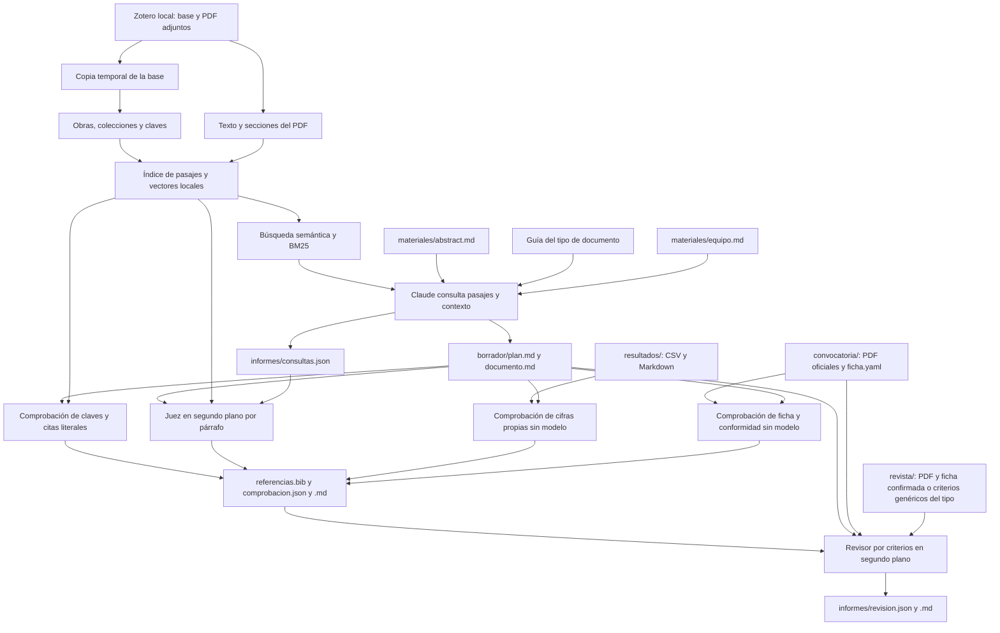

# Arquitectura

Claude Code planifica y escribe el documento siguiendo las instrucciones de `commands/`. El
servidor MCP proporciona acceso a los PDF del Zotero local y comprueba las citas. El código Python
no planifica ni redacta el documento.

## Módulos

Las rutas siguientes son relativas a `src/ai_writer/`, salvo donde se indica otra raíz.

| Módulo | Responsabilidad |
|---|---|
| `__init__.py` | Declara la versión del paquete. |
| `__main__.py` | Permite ejecutar la CLI con `python -m ai_writer`. |
| `main.py` | CLI con `version`, `documento verificar` y `documento revisar`. |
| `mcp_server.py` | Registra las herramientas de diagnóstico, proyecto, consulta y verificación. |
| `library.py` | Proyecto, plantillas de materiales, migración de informes y carpeta de documentos. |
| `estado.py` | Estado determinista del documento y siguiente paso, sin abrir el índice. |
| `exportacion.py` | Convierte el borrador y la bibliografía en DOCX con Pandoc y conserva la copia previa si la conversión falla. |
| `evidencia.py` | Inventaría los materiales y lee una celda CSV o un fragmento guardado en una salida de texto o Jupyter. |
| `hallazgos.py` | Registra propuestas y decisiones en SQLite, con la huella de la evidencia aprobada. |
| `hallazgos_borrador.py` | Coteja los enunciados del manuscrito con los hallazgos aprobados y señala cifras por vincular. |
| `avisos.py` | Añade y consume avisos pendientes en `informes/avisos.json`. |
| `zotero.py` | Lee obras, colecciones y adjuntos desde una copia temporal de la base de Zotero; asigna claves. |
| `passages.py` | Extrae y segmenta PDF, mantiene el índice incremental y busca o lee pasajes. |
| `segmentation.py` | Localiza títulos, elimina bibliografía y secciones administrativas, une y divide tramos. |
| `quotes.py` | Normaliza citas, busca fragmentos literales y explica diferencias con el texto más cercano. |
| `citations.py` | Genera claves, normaliza títulos y analiza citas Pandoc y marcas `[@?]`. |
| `sentences.py` | Separa frases, agrupa párrafos citados y elimina marcas de cita de la consulta del juez. |
| `consulta.py` | Abre el índice, aplica las colecciones del proyecto, registra consultas y genera BibTeX. |
| `verificacion.py` | Comprueba claves y citas literales, ejecuta el juez y guarda progreso e informes. |
| `revisor.py` | Evalúa el borrador por criterios en una llamada aparte, sin reescribir ni puntuar. |
| `cifras.py` | Comprueba cifras propias contra los CSV y Markdown de resultados, sin modelo. |
| `convocatoria.py` | Valida fichas de convocatoria y revista y sus citas en PDF; comprueba conformidad, sin modelo. |
| `guias/` | Guías de escritura Markdown y criterios genéricos YAML por tipo, incluidos en el paquete. |
| `background.py` | Lanza la CLI como proceso independiente y consulta si sigue vivo. |
| `embeddings/__init__.py` | Declara el paquete de búsqueda local. |
| `embeddings/embedder.py` | Interfaz de embeddings y backend local con fastembed, cargado bajo demanda. |
| `embeddings/bm25.py` | Tokenización y puntuación léxica BM25 con listas de documentos por término. |
| `llm/__init__.py` | Exporta el cliente, los tipos y los errores de generación. |
| `llm/client.py` | Cliente común: selección de backend, reintentos, JSON y contabilidad de uso. |
| `llm/backends/__init__.py` | Declara el paquete de backends del juez. |
| `llm/backends/claude_code.py` | Ejecuta `claude -p` con la sesión del usuario, sin herramientas ni servidores MCP. |
| `llm/backends/codex_cli.py` | Ejecuta `codex exec` con la sesión del usuario en un directorio temporal. |
| `config/__init__.py` | Exporta la configuración. |
| `config/settings.py` | Lee las opciones de modelos, ejecutables y caché del entorno y de `.env`. |
| `hooks/avisos.py` | En `UserPromptSubmit`, entrega los avisos pendientes sin bloquear. |
| `hooks/validar.py` | Tras una edición del borrador, bloquea claves desconocidas, mal formadas o fuera de las colecciones. |

El MCP expone `diagnostico`, `probar_claude`, `crear_documento`, `colecciones_zotero`, `estado_indice`,
`guia_escritura`, `estado_documento`, `estado_hallazgos`, `leer_evidencia_resultados`,
`guardar_hallazgos`, `decidir_hallazgos`, `comprobar_ficha`, `mostrar_ficha`, `confirmar_ficha`,
`buscar_pasajes`, `leer_pasaje`, `leer_paginas`, `referencia`,
`preparar_citas_vivas`, `comprobar_citas`, `comprobar_documento`, `estado_comprobacion`,
`evidencia_citas`, `revisar_documento`, `estado_revision` y `exportar_documento`.
La carpeta del documento se obtiene
de `CLAUDE_PROJECT_DIR` o del directorio
actual. Fuera de un documento, las consultas abarcan todo Zotero.

El camino de cinco verbos es `nuevo`, `escribir`, `comprobar`, `revisar` y `exportar` según
[exportar.md](exportar.md). Las ayudas son `estado`, `corregir`, `diagnostico`, que también
atiende consultas sobre la biblioteca, y `ayuda`, que explica los comandos a partir del manual. `corregir` muestra antes y después y solo aplica los cambios
aceptados; vuelve a comprobar sin juez. `escribir` comprueba al terminar y resume lo señalado.
Los comandos usan `estado_documento` para proponer el siguiente paso, su motivo y las alternativas. Avisa del gasto cuando corresponde.

## Flujo de datos



Zotero se lee desde una copia temporal de `zotero.sqlite` y, si existe, su WAL. Si la copia es
inconsistente porque Zotero escribió durante la copia, se intenta leer solo la base principal.
No se escribe en la carpeta de Zotero. Se incluyen las obras de la biblioteca personal y los PDF
adjuntos disponibles, tanto almacenados como enlazados. Una colección seleccionada incluye sus
subcolecciones.

`consulta.open_index` reutiliza el índice mientras no cambien las fechas de modificación de la
base y del WAL. La búsqueda actualiza antes las obras pendientes del ámbito del documento. La
lectura puede devolver el pasaje y sus vecinos, la sección completa o los pasajes que tocan un
intervalo de páginas, con un máximo de seis páginas solicitadas por llamada MCP.

## Formatos en disco

El índice está fuera de Zotero y del documento, por defecto en la carpeta de documentos del
usuario, bajo `TheAIWriter/indice`. `THEAIWRITER_INDICE` cambia esta ruta y `THEAIWRITER_ZOTERO`
permite indicar la carpeta de Zotero.

```text
indice/
    claves.json
    modelo.json
    obras/<ITEM_KEY>.json
    vectores/<ITEM_KEY>.npy
```

- `claves.json`: objeto que asocia la clave de ítem de Zotero con la clave de cita. Las claves ya
  asignadas se conservan. Para obras nuevas se adopta la clave de Zotero si existe y está libre;
  en otro caso se genera con apellido, año y una palabra del título, y se resuelven colisiones.
- `modelo.json`: objeto con `modelo` y `corte`, que identifican el modelo y la versión del corte.
- `obras/<ITEM_KEY>.json`: `huella` de los PDF (ruta, tamaño y fecha de modificación), número total
  de `paginas` y lista de `pasajes`. Cada pasaje incluye `n`, `seccion`, rango de `paginas`, `texto`,
  `archivo` y origen de las secciones en `secciones_por`.
- `vectores/<ITEM_KEY>.npy`: matriz NumPy con una fila normalizada por pasaje. Para obras sin texto
  se guarda una matriz vacía y se informa de ellas como `sin_texto`.

El identificador que reciben las herramientas es `<clave_de_cita>#<n>`. Solo se vuelven a leer los
PDF nuevos o modificados. Cambiar el modelo o la versión del corte invalida los pasajes y vectores
almacenados: la actualización los elimina y reconstruye las obras solicitadas. Conserva las claves.
Un PDF dañado se informa como fallido y no impide procesar los demás.

El documento tiene esta estructura:

```text
documento/
    proyecto.yaml
    materiales/
        abstract.md
        equipo.md     # solo para convocatoria: datos aportados por el usuario
    borrador/
        plan.md
        documento.md
        referencias.bib
    informes/
        consultas.json
        avisos.json
        comprobacion.json
        comprobacion.md
        comprobacion.log
        revision.json
        revision.md
        revision.log
    exportacion/
    resultados/       # solo para tipo resultados: tablas CSV, figuras y salidas Markdown
    analisis/         # solo para tipo resultados: código que produce los resultados
    convocatoria/     # solo para convocatoria: PDF oficiales y ficha.yaml
    revista/          # opcional para artículos: PDF de normas o guía de revisores y ficha.yaml
```

`Project.create` crea el YAML y las cuatro carpetas comunes; para `resultados` añade `resultados/`
y `analisis/`; para `convocatoria`, `convocatoria/` y la plantilla `materiales/equipo.md`.
Prepara `materiales/abstract.md` con preguntas por tipo y `equipo.md` con preguntas por apartado,
en comentarios HTML. Conserva ambos si ya existen. `is_template` descarta comentarios, títulos y
espacios: una plantilla sin respuestas se trata como vacía en `guia_escritura`. Valida las
colecciones contra Zotero antes
de guardar. Solo tiene los campos
`tipo` (`perspectiva` para un ensayo, `resultados` para un artículo con resultados propios o
`convocatoria` para una memoria de solicitud),
`titulo`, `idioma` (por defecto `es`) y `colecciones` (lista vacía: todo Zotero). Al cargar se
ignoran campos adicionales de proyectos antiguos, incluido `fuente`.

Claude escribe `abstract.md`, `plan.md` y `documento.md` siguiendo los comandos. El plugin escribe
`referencias.bib` al verificar, con las obras citadas válidas y sus claves del índice.
`exportacion/` se crea vacía. `exportar_documento` genera allí `documento.docx` al pedir la exportación.

Tras leer `proyecto.yaml`, el comando de escritura llama obligatoriamente a `guia_escritura`.
La herramienta lee con `importlib.resources` el Markdown del tipo en `guias/`; el paquete instalado
incluye las tres guías. `commands/escribir.md` contiene el flujo común y las guías contienen las
reglas específicas de preparación, estructura y escritura de cada tipo.

`convocatoria/ficha.yaml` se valida con modelos Pydantic, igual que `Project`. Contiene el nombre,
`confirmada`, el plazo, los apartados (título, nivel 2 o 3, obligatoriedad, condición, petición y
criterios), los límites de páginas y caracteres, la regla de idioma y los criterios de evaluación
con puntuaciones y umbrales. Cada apartado, campo, regla de idioma y criterio lleva `fuente`
(`fichero`, `pagina` desde 1 y `cita` literal); el límite de páginas también la exige. Sin límite
de páginas, esa fuente puede omitirse. `palabras_por_pagina` vale 500 por defecto.
Claude redacta la ficha leyendo los PDF oficiales, la comprueba con `comprobar_ficha` y pide la
confirmación del usuario tras enseñar `mostrar_ficha`, sin mostrar el YAML salvo petición.
Solo después del sí llama a `confirmar_ficha`: vuelve a comprobar las fuentes, rechaza errores o
citas fallidas y cambia solo la línea de primer nivel `confirmada: false` por `confirmada: true`
(o la añade tras la primera línea), conservando comentarios y formato.

`consultas.json` contiene `consultas` (texto de cada búsqueda y los identificadores devueltos) y
`pasajes` (identificadores consultados sin duplicados). Las lecturas añaden pasajes a esta segunda
lista. El juez usa este registro para incluir contexto que vio Claude.

`comprobacion.json` contiene la fecha `comprobado`, el resultado de `citas`, las `citas_literales`,
la ruta de la `bibliografia`, el estado y progreso de `juez` y las entradas de `apoyo` por frase y
obra. Cada veredicto guarda la huella de los PDF indexados. Cuando el juez señala un pasaje,
el informe conserva su identificador, el adjunto y las páginas. Los índices anteriores recuperan
la clave de adjunto cuando el nombre de archivo es inequívoco. `comprobacion.md` presenta estos
datos al usuario, incluidos los pasajes de citas apoyadas. `comprobacion.log` recoge la salida
del proceso independiente. En documentos de tipo `resultados` sin vínculos ni registro,
la clave `cifras` añade las cifras
`comprobadas`, las que tienen origen (`con_origen`), las entradas `sin_origen` con cifra, sección y
frase, los `ficheros` leídos y un `aviso` si no hay resultados numéricos.
Si hay un registro o vínculos a hallazgos, `hallazgos_borrador` incluye el estado de cada vínculo, la línea, el enunciado aprobado y su fuente. Las versiones de los hallazgos vinculados permiten detectar que el informe se ha quedado desactualizado aunque el borrador siga igual.

Solo para `convocatoria`, `ficha` añade requisitos comprobados, fallidos, avisos y confirmación;
`convocatoria` añade apartados ausentes o sobrantes, orden, extensión, campos y pendientes.
Si la ficha no valida o tiene citas fallidas, se devuelve un aviso en lugar de comprobar la
conformidad. Una ficha sin confirmar se comprueba igualmente y el informe señala que falta
la confirmación; la guía impide escribir el borrador hasta obtenerla.

`revision.json` contiene `estado`, `pid`, `inicio`, `fin`, `origen`, `criterios`, `prioridades` y
`error`. Por criterio guarda nombre, nivel (`bien`, `mejorable`, `flojo` o `sin_evaluar` si falta
una respuesta válida), fortalezas, carencias con apartado y problema, y trabajo para el autor.
`revision.md` presenta las prioridades y cada criterio; `revision.log` recoge la salida del proceso.

`Project.load` migra la carpeta antigua `revision/` a `informes/` si esta última no existe, y
renombra `verificacion.{json,md,log}` a `comprobacion.*`. No mezcla dos carpetas existentes.
La migración deja un aviso, igual que `run_judge` y `run_review` al terminar, fallar o detenerse
por límite. `avisos.json` es una lista de objetos con `texto` y `fecha`; `pop_notices` la devuelve
y vacía. El hook `UserPromptSubmit` usa el `cwd` de la entrada, exige `proyecto.yaml`, consume los
avisos y los añade a `additionalContext`. Sin avisos o ante un fallo sale silencioso con código 0;
no carga embeddings ni llama a modelos.

`estado_documento` lee los materiales y los informes. Compara la huella del borrador con la de cada
informe y usa la fecha de modificación con informes anteriores que carecen de huella. En convocatorias
comprueba que haya equipo y PDF oficiales. En resultados busca una tabla, una salida de texto o
una salida guardada de Jupyter y resume el estado de las aprobaciones. La comprobación incluye el
total de pares de frase y obra, incluso mientras hay pares pendientes. `siguiente`,
`motivo_siguiente` y `alternativas` orientan al usuario según el estado actual. La exportación usa Pandoc para guardar un DOCX en `exportacion/`. `preparar_citas_vivas` copia el borrador con las claves que Zotero guarda en `citationKey` o en `extra`, las de Better BibTeX.

## Secciones sin modelo

PyMuPDF extrae los bloques de texto de cada página. Se intenta reconocer secciones en este orden:

1. Títulos de los niveles uno y dos del índice interno del PDF.
2. Líneas que parecen títulos por su tamaño o negrita respecto al cuerpo, con reglas para excluir
   pies de figura, cabeceras repetidas, autores y el título del artículo. También se reconocen
   nombres habituales de secciones.
3. Corte por tamaño si ninguna de las fuentes anteriores localiza al menos tres títulos en orden.

`segmentation.segment` busca los títulos en el texto, descarta entradas de tablas de contenido,
secciones administrativas y bibliografía; los apéndices reconocidos después de las referencias
pueden reanudar el cuerpo. Une secciones pequeñas y divide las grandes por párrafos, después por
frases y, si hace falta, por palabras. Los nombres de secciones unidas se concatenan.

`passages.cut_pdf` usa objetivos de 150 a 300 palabras y conserva los rangos de páginas mediante
los desplazamientos en el texto. Une fragmentos de menos de 80 palabras con un vecino de la misma
sección resultante; por ello el tamaño final puede superar 300 palabras. Junta líneas y deshace
los guiones de final de línea. No usa un modelo ni hace OCR.

## Búsqueda por significado y palabras

El backend local usa fastembed y, por defecto, `intfloat/multilingual-e5-small`. Los textos que se
vectorizan incluyen título de la obra, sección y pasaje. Los modelos E5 reciben los prefijos
`passage:` y `query:`. El modelo se carga y descarga de la red solo cuando se necesita por primera
vez; después se reutiliza la caché local.

La puntuación semántica es el producto escalar de vectores normalizados. BM25 calcula la
coincidencia de palabras sobre el texto del pasaje, con tokens en minúsculas, sin tildes y de al
menos dos caracteres. Visita las listas de documentos de los términos de la consulta.

Cuando hay coincidencias léxicas, se estandarizan ambas puntuaciones restando su media y
dividiendo por su desviación típica, y se suman con peso 0,5 para cada una. Si no hay coincidencias
léxicas, se usa solo la puntuación semántica. Los resultados se ordenan por puntuación y se filtran
por colecciones y por el máximo de pasajes por obra: ocho resultados y tres por obra por defecto.
Cada resultado lleva identificador, clave, título, año, sección, páginas y texto literal.

## Las seis comprobaciones

**Claves y ámbito.** `find_citations` acepta `[@clave]`, grupos `[@a; @b]` y localizadores como
`[@clave, p. 4]`. Cuenta `[@?]` como pendiente y devuelve los grupos mal formados. La verificación
separa claves válidas, desconocidas, fuera de las colecciones y sin pasajes indexados.
Cuando hay colecciones seleccionadas, `citas.en_coleccion` cuenta sus obras y `citas.sin_citar`
enumera las claves que el borrador no cita. El informe muestra la cobertura para revisar si alguna
de esas obras aporta algo que falta; no exige citarlas todas.
El hook hace solo el control de claves y ámbito, sin cargar embeddings. Sus dependencias son
`pydantic` y `pyyaml`. Permanece silencioso cuando no hay citas incorrectas, incluso con `[@?]`.

**Citas literales.** Se buscan comillas angulares, inglesas y rectas en las frases con citas. Las
citas de seis palabras o más se comparan con el texto indexado de las obras citadas. Se normalizan
caracteres, puntuación, mayúsculas y guiones de final de línea; se toleran palabras separadas o
unidas por la extracción y números de notas. Los fragmentos separados por omisiones deben aparecer
en orden. Una palabra añadida, quitada o cambiada no se acepta como literal; se busca el texto más
cercano para mostrar las diferencias. Estas dos comprobaciones no llaman a ningún modelo.

**Apoyo de cada frase.** `sentences.py` divide párrafos sin cortar citas, abreviaturas comunes ni
decimales. Por cada pareja frase–obra se seleccionan hasta cuatro pasajes cercanos a la frase y
hasta 16 consultados al escribir que no estén ya entre esos cuatro. El juez recibe esos pasajes y
el párrafo del borrador, que solo sirve para resolver a qué se refiere la frase, y devuelve `apoyada`, `parcial`, `tergiversada` o `no_apoyada`, un motivo y, si lo indica,
un pasaje mostrado. Una clave desconocida, una obra sin pasajes o una respuesta ilegible quedan
`sin_juzgar`.

Se agrupan las parejas de un párrafo en una llamada al backend, por defecto `claude -p`. Solo se
llama si hay parejas con pasajes para comparar. `start_judge` lanza
`python -m ai_writer documento verificar <carpeta>` mediante `background.spawn_cli`. Guarda el
progreso tras cada párrafo. Conserva los veredictos previos de la misma frase y clave si tampoco
ha cambiado la frase anterior (`previa`), y reanuda tras un límite de uso. `current_support` ajusta
los veredictos al borrador en cada comprobación: descarta las frases que ya no están, deja las
nuevas `sin_juzgar` y pone el juez terminado en estado `desactualizado`; el estado también distingue procesos interrumpidos y errores. El porcentaje
de apoyo cuenta entradas apoyadas entre las juzgadas, excluyendo las que quedan sin juzgar.
El juez es automático, puede equivocarse y no sustituye la revisión del artículo.

**Frases sin cita.** `uncited_attributions` señala en `atribuciones_sin_cita` las frases sin cita que
nombran a un autor de la biblioteca (apellidos de cuatro letras o más, sacados de las claves) o usan
fórmulas como «el trabajo original». No usa un modelo: puede avisar de más y pasar por alto otras.

**Cifras propias.** Solo para `resultados`, `check_figures` comprueba decimales con coma o punto y
porcentajes contra las celdas numéricas de todos los CSV y los números de todos los Markdown de
`resultados/`, de forma recursiva. Usa `csv`, con separador coma o punto y coma, y no llama a un
modelo. Acepta el redondeo de Python y el de mitad hacia arriba, con tolerancia de 1e-9; para
porcentajes compara también con el valor multiplicado por cien. No comprueba enteros sin porcentaje,
secciones de segundo nivel cuyo título sin tildes y en minúsculas empiece por `introduc`, `metod`
o `method`, frases con cita, código ni destinos de enlaces o imágenes. El informe incluye cada
cifra sin origen con su sección y frase, y recuerda que encontrarla en los resultados no confirma
que la frase la describa bien.

En este tipo de documento, Claude lee `resultados/` y `analisis/` antes de planificar. Escribe
Introducción, Métodos, Resultados, Discusión y Conclusión, en el idioma del documento. Toda cifra
propia procede de las tablas o de un script de `analisis/` cuya salida CSV o Markdown queda en
`resultados/`, también para los recuentos y diferencias citados. Estas cifras no llevan cita;
Introducción y Discusión mantienen la búsqueda y las reglas de citas habituales.

**Convocatoria.** Solo para `convocatoria`, `check_ficha` exige que cada fuente sea un PDF dentro
de `convocatoria/`, extrae su texto por páginas con `passages.page_texts` y reutiliza
`verificacion.verbatim` para comprobar citas de al menos seis palabras. Cuenta cada fuente como
un requisito; una cita presente fuera de la página indicada ±1 es un aviso, no un fallo.
No usa el índice de Zotero ni un modelo.

`check_call` compara encabezados de nivel 2 y 3 por igualdad, sin tildes, mayúsculas, numeración
inicial ni puntuación final, y con espacios compactados. Informa de apartados obligatorios que
faltan, condicionales ausentes con su condición, encabezados sobrantes y el primer apartado fuera
de orden. Cuenta palabras sin títulos de nivel 1 ni bloques de código; estima páginas con un
decimal y avisa desde el 90 % del máximo. Los campos asociados a un apartado cuentan caracteres
del cuerpo Markdown, con espacios y texto de subsecciones, sin encabezados ni bloques de código;
un apartado ausente se informa como tal. Los campos sin apartado quedan en `a_mano`.
Las marcas `[PENDIENTE: …]` se informan con su sección. La sección «Convocatoria» del informe
recuerda que hay que comprobar las páginas reales en la plantilla oficial.

La guía exige un presupuesto de palabras por apartado y una tabla de criterios y secciones
que los cubren. El borrador conserva títulos, niveles y orden de la ficha; el plan justifica los
apartados condicionales omitidos. Equipo, resultados previos, recursos, cronograma y presupuesto
proceden solo de `materiales/equipo.md`, con marcas pendientes para los datos que falten.
El estado del arte y la motivación conservan las búsquedas y citas comunes; las hipótesis no se
presentan como resultados prometidos.

## Revisión por criterios

`review_criteria` usa la ficha de convocatoria o, para los artículos que la tengan, la ficha de
revista. Ambas deben ser válidas, tener criterios, estar confirmadas y no tener citas fallidas.
`JournalFicha` guarda `revista`, `confirmada` y al menos un criterio con nombre, descripción,
máximo y umbral opcionales y fuente. `check_sources` comparte la comprobación de citas literales
entre `convocatoria/` y `revista/`, sin modelo. Sin revista, los criterios se leen con
`importlib.resources` de `guias/criterios-<tipo>.yaml`.

`start_review` comprueba los criterios antes de lanzar `documento revisar` con `spawn_cli`.
`run_review` envía el borrador entero, los criterios y un resumen de verificación en una sola
llamada, sin el contexto de la sesión que escribió. Actualiza las comprobaciones deterministas
con `check_document(bibliography=False)`, sin escribir en `borrador/`, y usa `summary` para el
apoyo previo del juez. Incluye cobertura, frases que revisar y, en convocatorias, apartados que
faltan, extensión y número de pendientes. No vuelve a juzgar las citas.

El resultado propone trabajo, sin reescribir ni dar notas. Los pendientes cuentan como datos que
conseguir; reconocer limitaciones y riesgos es una fortaleza. La evaluación es automática y
orientativa y no sustituye a la de la convocatoria o revista. Los estados distinguen ejecución,
finalización, límite de uso, error e interrupción si murió el proceso.

## Decisiones y mediciones

Con 12 artículos, el nuevo flujo obtuvo un 90 % y un 86 % de frases apoyadas, frente al 66 % de las
mejores versiones anteriores.

Con 50 artículos, los pasajes obtuvieron un 85 % y el índice de ideas extraídas con un LLM un
89 %, en una ejecución por condición: un empate dentro del ruido. El índice de ideas costó
660 llamadas a un LLM y el de pasajes ninguna. Por eso se retiró la extracción de ideas.

