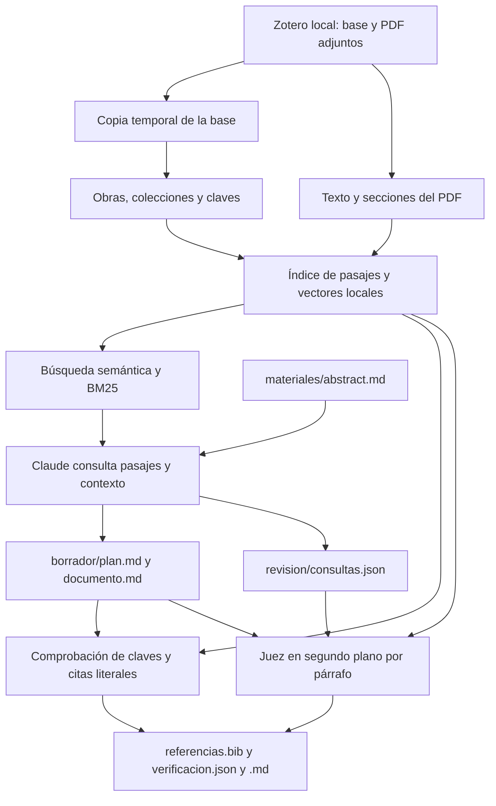

# Arquitectura

Claude Code planifica y escribe el documento siguiendo las instrucciones de `commands/`. El
servidor MCP proporciona acceso a los PDF del Zotero local y comprueba las citas. El código Python
no planifica ni redacta el documento.

## Módulos

Las rutas siguientes son relativas a `src/ai_writer/`, salvo donde se indica otra raíz.

| Módulo | Responsabilidad |
|---|---|
| `__init__.py` | Declara la versión del paquete. |
| `__main__.py` | Permite ejecutar la CLI con `python -m ai_writer`. |
| `main.py` | CLI con `version` y `documento verificar <carpeta>`. |
| `mcp_server.py` | Registra las herramientas de diagnóstico, proyecto, consulta y verificación. |
| `library.py` | `Project`, `LibraryError`, `PROJECT_FILE` y localización de la carpeta de documentos. |
| `zotero.py` | Lee obras, colecciones y adjuntos desde una copia temporal de la base de Zotero; asigna claves. |
| `passages.py` | Extrae y segmenta PDF, mantiene el índice incremental y busca o lee pasajes. |
| `segmentation.py` | Localiza títulos, elimina bibliografía y secciones administrativas, une y divide tramos. |
| `quotes.py` | Normaliza citas, busca fragmentos literales y explica diferencias con el texto más cercano. |
| `citations.py` | Genera claves, normaliza títulos y analiza citas Pandoc y marcas `[@?]`. |
| `sentences.py` | Separa frases, agrupa párrafos citados y elimina marcas de cita de la consulta del juez. |
| `consulta.py` | Abre el índice, aplica las colecciones del proyecto, registra consultas y genera BibTeX. |
| `verificacion.py` | Comprueba claves y citas literales, ejecuta el juez y guarda progreso e informes. |
| `background.py` | Lanza la CLI como proceso independiente y consulta si sigue vivo. |
| `embeddings/__init__.py` | Declara el paquete de búsqueda local. |
| `embeddings/embedder.py` | Interfaz de embeddings y backend local con fastembed, cargado bajo demanda. |
| `embeddings/bm25.py` | Tokenización y puntuación léxica BM25 con listas de documentos por término. |
| `llm/__init__.py` | Exporta el cliente, los tipos y los errores de generación. |
| `llm/client.py` | Cliente común: selección de backend, reintentos, JSON y contabilidad de uso. |
| `llm/backends/__init__.py` | Declara el paquete de backends del juez. |
| `llm/backends/claude_code.py` | Ejecuta `claude -p` con la sesión del usuario, sin herramientas ni servidores MCP. |
| `llm/backends/codex_cli.py` | Ejecuta `codex exec` con la sesión del usuario en un directorio temporal. |
| `config/__init__.py` | Exporta la configuración. |
| `config/settings.py` | Lee las opciones de modelos, ejecutables y caché del entorno y de `.env`. |
| `hooks/validar.py` | Tras una edición del borrador, bloquea claves desconocidas, mal formadas o fuera de las colecciones. |

El MCP expone `diagnostico`, `probar_claude`, `crear_documento`, `colecciones_zotero`, `estado_indice`,
`buscar_pasajes`, `leer_pasaje`, `leer_paginas`, `referencia`, `validar_citas`, `verificar_documento`
y `estado_verificacion`. La carpeta del documento se obtiene de `CLAUDE_PROJECT_DIR` o del directorio
actual. Fuera de un documento, las consultas abarcan todo Zotero.

## Flujo de datos



Zotero se lee desde una copia temporal de `zotero.sqlite` y, si existe, su WAL. Si la copia es
inconsistente porque Zotero escribió durante la copia, se intenta leer solo la base principal.
No se escribe en la carpeta de Zotero. Se incluyen las obras de la biblioteca personal y los PDF
adjuntos disponibles, tanto almacenados como enlazados. Una colección seleccionada incluye sus
subcolecciones.

`consulta.open_index` reutiliza el índice mientras no cambien las fechas de modificación de la
base y del WAL. La búsqueda actualiza antes las obras pendientes del ámbito del documento. La
lectura puede devolver el pasaje y sus vecinos, la sección completa o los pasajes que tocan un
intervalo de páginas, con un máximo de seis páginas solicitadas por llamada MCP.

## Formatos en disco

El índice está fuera de Zotero y del documento, por defecto en la carpeta de documentos del
usuario, bajo `TheAIWriter/indice`. `THEAIWRITER_INDICE` cambia esta ruta y `THEAIWRITER_ZOTERO`
permite indicar la carpeta de Zotero.

```text
indice/
    claves.json
    modelo.json
    obras/<ITEM_KEY>.json
    vectores/<ITEM_KEY>.npy
```

- `claves.json`: objeto que asocia la clave de ítem de Zotero con la clave de cita. Las claves ya
  asignadas se conservan. Para obras nuevas se adopta la clave de Zotero si existe y está libre;
  en otro caso se genera con apellido, año y una palabra del título, y se resuelven colisiones.
- `modelo.json`: objeto con `modelo` y `corte`, que identifican el modelo y la versión del corte.
- `obras/<ITEM_KEY>.json`: `huella` de los PDF (ruta, tamaño y fecha de modificación), número total
  de `paginas` y lista de `pasajes`. Cada pasaje incluye `n`, `seccion`, rango de `paginas`, `texto`,
  `archivo` y origen de las secciones en `secciones_por`.
- `vectores/<ITEM_KEY>.npy`: matriz NumPy con una fila normalizada por pasaje. Para obras sin texto
  se guarda una matriz vacía y se informa de ellas como `sin_texto`.

El identificador que reciben las herramientas es `<clave_de_cita>#<n>`. Solo se vuelven a leer los
PDF nuevos o modificados. Cambiar el modelo o la versión del corte invalida los pasajes y vectores
almacenados: la actualización los elimina y reconstruye las obras solicitadas. Conserva las claves.
Un PDF dañado se informa como fallido y no impide procesar los demás.

El documento tiene esta estructura:

```text
documento/
    proyecto.yaml
    materiales/
        abstract.md
    borrador/
        plan.md
        documento.md
        referencias.bib
    revision/
        consultas.json
        verificacion.json
        verificacion.md
        verificacion.log
    exportacion/
```

`Project.create` crea el YAML y las cuatro carpetas. Valida las colecciones contra Zotero antes
de guardar. Solo tiene los campos `tipo` (literal `perspectiva`), `titulo`, `idioma` (por defecto
`es`) y `colecciones` (lista vacía: todo Zotero). Al cargar se ignoran campos adicionales de
proyectos antiguos, incluido `fuente`.

Claude escribe `abstract.md`, `plan.md` y `documento.md` siguiendo los comandos. El plugin escribe
`referencias.bib` al verificar, con las obras citadas válidas y sus claves del índice.
`exportacion/` se crea vacía; no hay un exportador en el código.

`consultas.json` contiene `consultas` (texto de cada búsqueda y los identificadores devueltos) y
`pasajes` (identificadores consultados sin duplicados). Las lecturas añaden pasajes a esta segunda
lista. El juez usa este registro para incluir contexto que vio Claude.

`verificacion.json` contiene la fecha `comprobado`, el resultado de `citas`, las `citas_literales`,
la ruta de la `bibliografia`, el estado y progreso de `juez` y las entradas de `apoyo` por frase y
obra. `verificacion.md` presenta estos datos al usuario; `verificacion.log` recoge la salida del
proceso independiente.

## Secciones sin modelo

PyMuPDF extrae los bloques de texto de cada página. Se intenta reconocer secciones en este orden:

1. Títulos de los niveles uno y dos del índice interno del PDF.
2. Líneas que parecen títulos por su tamaño o negrita respecto al cuerpo, con reglas para excluir
   pies de figura, cabeceras repetidas, autores y el título del artículo. También se reconocen
   nombres habituales de secciones.
3. Corte por tamaño si ninguna de las fuentes anteriores localiza al menos tres títulos en orden.

`segmentation.segment` busca los títulos en el texto, descarta entradas de tablas de contenido,
secciones administrativas y bibliografía; los apéndices reconocidos después de las referencias
pueden reanudar el cuerpo. Une secciones pequeñas y divide las grandes por párrafos, después por
frases y, si hace falta, por palabras. Los nombres de secciones unidas se concatenan.

`passages.cut_pdf` usa objetivos de 150 a 300 palabras y conserva los rangos de páginas mediante
los desplazamientos en el texto. Une fragmentos de menos de 80 palabras con un vecino de la misma
sección resultante; por ello el tamaño final puede superar 300 palabras. Junta líneas y deshace
los guiones de final de línea. No usa un modelo ni hace OCR.

## Búsqueda por significado y palabras

El backend local usa fastembed y, por defecto, `intfloat/multilingual-e5-small`. Los textos que se
vectorizan incluyen título de la obra, sección y pasaje. Los modelos E5 reciben los prefijos
`passage:` y `query:`. El modelo se carga y descarga de la red solo cuando se necesita por primera
vez; después se reutiliza la caché local.

La puntuación semántica es el producto escalar de vectores normalizados. BM25 calcula la
coincidencia de palabras sobre el texto del pasaje, con tokens en minúsculas, sin tildes y de al
menos dos caracteres. Visita las listas de documentos de los términos de la consulta.

Cuando hay coincidencias léxicas, se estandarizan ambas puntuaciones restando su media y
dividiendo por su desviación típica, y se suman con peso 0,5 para cada una. Si no hay coincidencias
léxicas, se usa solo la puntuación semántica. Los resultados se ordenan por puntuación y se filtran
por colecciones y por el máximo de pasajes por obra: ocho resultados y tres por obra por defecto.
Cada resultado lleva identificador, clave, título, año, sección, páginas y texto literal.

## Las tres comprobaciones

**Claves y ámbito.** `find_citations` acepta `[@clave]`, grupos `[@a; @b]` y localizadores como
`[@clave, p. 4]`. Cuenta `[@?]` como pendiente y devuelve los grupos mal formados. La verificación
separa claves válidas, desconocidas, fuera de las colecciones y sin pasajes indexados. El hook
hace solo el control de claves y ámbito, sin cargar embeddings. Sus dependencias de script son
`pydantic` y `pyyaml`. Permanece silencioso cuando no hay citas incorrectas, incluso con `[@?]`.

**Citas literales.** Se buscan comillas angulares, inglesas y rectas en las frases con citas. Las
citas de seis palabras o más se comparan con el texto indexado de las obras citadas. Se normalizan
caracteres, puntuación, mayúsculas y guiones de final de línea; se toleran palabras separadas o
unidas por la extracción y números de notas. Los fragmentos separados por omisiones deben aparecer
en orden. Una palabra añadida, quitada o cambiada no se acepta como literal; se busca el texto más
cercano para mostrar las diferencias. Estas dos comprobaciones no llaman a ningún modelo.

**Apoyo de cada frase.** `sentences.py` divide párrafos sin cortar citas, abreviaturas comunes ni
decimales. Por cada pareja frase–obra se seleccionan hasta cuatro pasajes cercanos a la frase y
hasta dos consultados al escribir que no estén ya entre esos cuatro. El juez solo recibe esos
pasajes y devuelve `apoyada`, `parcial`, `tergiversada` o `no_apoyada`, un motivo y, si lo indica,
un pasaje mostrado. Una clave desconocida, una obra sin pasajes o una respuesta ilegible quedan
`sin_juzgar`.

Se agrupan las parejas de un párrafo en una llamada al backend, por defecto `claude -p`. Solo se
llama si hay parejas con pasajes para comparar. `start_judge` lanza
`python -m ai_writer documento verificar <carpeta>` mediante `background.spawn_cli`. Guarda el
progreso tras cada párrafo. Conserva los veredictos previos de la misma frase y clave y reanuda
tras un límite de uso; el estado también distingue procesos interrumpidos y errores. El porcentaje
de apoyo cuenta entradas apoyadas entre las juzgadas, excluyendo las que quedan sin juzgar.
El juez es automático, puede equivocarse y no sustituye la revisión del artículo.

## Decisiones y mediciones

Con 12 artículos, el nuevo flujo obtuvo un 90 % y un 86 % de frases apoyadas, frente al 66 % de las
mejores versiones anteriores.

Con 50 artículos, los pasajes obtuvieron un 85 % y el índice de ideas extraídas con un LLM un
89 %, en una ejecución por condición: un empate dentro del ruido. El índice de ideas costó
660 llamadas a un LLM y el de pasajes ninguna. Por eso se retiró la extracción de ideas.

Los detalles están en [herramienta-zotero-pasajes.md](../plans/pending/herramienta-zotero-pasajes.md).
