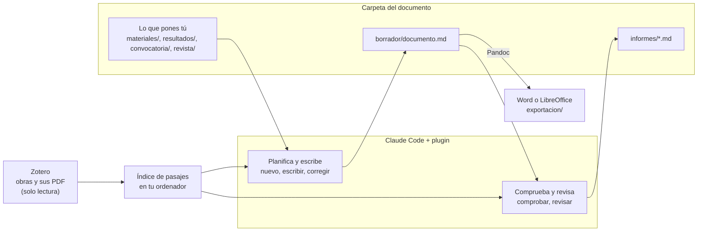

# Manual de TheAIWriter

Claude escribe en tu sesión de Claude Code. El plugin le da acceso a los PDF de tu Zotero y comprueba lo que escribe. Todo queda en la carpeta del documento.

## Cómo se conecta



## El camino: qué entra y qué sale

| Paso | Entra | Sale |
| --- | --- | --- |
| `/theaiwriter:nuevo` | Título, tipo, idioma y colecciones de Zotero | `proyecto.yaml`, carpetas y plantillas con preguntas |
| `/theaiwriter:hallazgos` (Resultados) | Tablas, salidas guardadas y tu decisión | Hallazgos que has aprobado o dejado pendientes |
| `/theaiwriter:escribir con pausa` | `materiales/abstract.md` y lo propio del tipo | `borrador/plan.md`, `documento.md`, `referencias.bib` |
| `/theaiwriter:comprobar` | El borrador, los hallazgos aprobados y los PDF de Zotero | `informes/comprobacion.md` |
| `/theaiwriter:corregir` | El informe y tu elección: todas, «1, 3» o ninguna | `documento.md` corregido |
| `/theaiwriter:revisar` | El borrador y los criterios de la convocatoria o revista | `informes/revision.md` |
| `/theaiwriter:exportar` | `documento.md`, `referencias.bib`, estilo CSL y plantilla opcionales | `exportacion/documento.docx` |

Los comandos muestran el siguiente paso, por qué toca y qué alternativas tienes. Usa `/theaiwriter:estado` para retomar el trabajo, `/theaiwriter:ayuda` para una duda («cómo paso a Word») y `/theaiwriter:diagnostico` para comprobar la instalación o Zotero.

## Antes de empezar

- **Claude Code**, en la aplicación de escritorio o en la terminal, con tu cuenta.
- **Zotero** en el mismo ordenador, con los PDF adjuntos a las obras. Las obras sin PDF no se pueden consultar ni comprobar, y los PDF escaneados sin texto tampoco.
- **uv** instalado.

```text
/plugin marketplace add mikelval82/TheAiWriter
/plugin install theaiwriter@theaiwriter
```

Reinicia Claude Code y escribe `/theaiwriter:diagnostico`. La primera vez que se indexan artículos se descarga el modelo de búsqueda, de unos cientos de MB.

## Uso, paso a paso

1. **Crea el documento.** Abre Claude Code en una carpeta vacía y escribe `/theaiwriter:nuevo` con tu idea. Te propone título, tipo, idioma y colección; contesta «vale» o di qué cambias.
2. **Rellena los materiales.** Contesta las preguntas de `materiales/abstract.md` y añade los archivos de tu tipo de documento. `/theaiwriter:estado` te dice lo que falta.
3. **Escribe.** En un estudio con resultados propios, usa primero `/theaiwriter:hallazgos` para revisar los hallazgos. Luego `/theaiwriter:escribir con pausa` deja el plan en `borrador/plan.md` y espera. Léelo, pide cambios y contesta «aprobado». Al acabar comprueba el borrador.
4. **Lee la comprobación y corrige.** Las comprobaciones sin modelo salen al momento. El juez tarda unos minutos y Claude te avisa en tu siguiente mensaje. Mira las frases tergiversadas, no apoyadas y parciales, y usa `/theaiwriter:corregir`. Después, `/theaiwriter:comprobar` vuelve a juzgar las frases cambiadas.
5. **Revisa por criterios.** `/theaiwriter:revisar`, o con el nombre de una revista y sus normas en `revista/`. Si hay ficha de criterios, te la enseña y espera tu «sí».
6. **Pásalo a Word** con `/theaiwriter:exportar`. Para actualizar una copia anterior, usa `/theaiwriter:exportar reemplazar`. [Guía de exportación](exportar.md)

En una convocatoria, `/theaiwriter:escribir solo ficha` permite revisar las reglas sin modificar el borrador. Si editas una regla o cambia su página de origen, vuelve a aprobar lo afectado. Las fichas anteriores se pueden abrir y requieren una confirmación inicial para guardar las aprobaciones por regla.

Si las bases fijan máximos distintos por modalidad, el plugin te pide elegir antes de planificar. Usa `/theaiwriter:escribir modalidad` para consultar o cambiar la elección. `/theaiwriter:comprobar sin juez` muestra la estimación de extensión para el límite aplicable, junto con su PDF, página y cita.

**Qué gasta de tu cuenta.** La conversación con Claude, sobre todo al escribir. Además, el juez hace una llamada por cada párrafo con citas y el revisor una por revisión. «Comprobar sin juez», `estado` y el índice no lanzan llamadas aparte.

## Archivos de entrada

| Archivo o carpeta | Perspectiva | Resultados | Convocatoria | Qué contiene |
| --- | --- | --- | --- | --- |
| Colección de Zotero | sí | sí | sí | Las obras que se pueden citar, con su PDF. Si no eliges ninguna, se usa todo Zotero |
| `materiales/abstract.md` | sí | sí | sí | Tus respuestas a las preguntas de la plantilla |
| Notas en `materiales/` | — | opcional | — | Detalles del estudio y decisiones del análisis |
| `resultados/` | — | si no usas salidas de un cuaderno | — | Tablas CSV, figuras y salidas en Markdown o texto |
| `analisis/` | — | opcional | — | Los scripts y cuadernos que produjeron los resultados |
| `materiales/equipo.md` | — | — | sí | Personas y papel, resultados previos, recursos, presupuesto y duración. Lo que falte se marca `[PENDIENTE]`, no se inventa |
| `convocatoria/*.pdf` | — | — | sí | Convocatoria, instrucciones de la memoria y plantilla oficiales |
| `revista/*.pdf` | opcional | opcional | — | Guía para revisores o normas de autores. Vale una web guardada con Ctrl+P, si el texto se puede seleccionar |

## Cómo aprobar hallazgos de tu estudio

1. Pon las notas en `materiales/`, las tablas y figuras en `resultados/` y los scripts y cuadernos en `analisis/`.
2. Escribe `/theaiwriter:hallazgos`. Comprueba el valor, el grupo y la ubicación de cada propuesta. En un CSV, la fila 1 es el primer registro después de la cabecera. En un cuaderno se cuentan todas las celdas desde 1 y se usan sus salidas guardadas.
3. Responde «aprobar 1 y 3», «editar 2» o «dejar pendiente 2». Puedes volver con `/theaiwriter:hallazgos ver` al abrir otra sesión. Si cambia una fuente, verás qué hallazgo vuelve a revisión.
4. Usa `/theaiwriter:escribir` para redactar con los hallazgos aprobados o `/theaiwriter:escribir solo Métodos` para avanzar mientras los revisas. Aprueba el plan antes de redactar. Si ya existe la sección, puedes revisar en bloque los cambios que propone.
5. Usa `/theaiwriter:comprobar sin juez` para comprobar los vínculos con los hallazgos. El informe muestra la frase, el grupo y la ubicación del dato. Si la frase cambia, puedes restaurar la aprobada o volver a `/theaiwriter:hallazgos` para aprobar la nueva formulación.

Si un cuaderno tiene solo una imagen como salida o todavía no se ha ejecutado, adjunta la tabla o guarda una salida de texto con el valor. La revisión del hallazgo incluye su significado y unidad. Al redactar, verás un comentario como `<!-- hallazgo:1 -->` al final de la línea del hallazgo en Markdown. El vínculo permite comprobar esa línea después de editarla.

## Consultar la evidencia en Introducción y Discusión

El informe de comprobación muestra las frases citadas, sus veredictos y los pasajes señalados por el juez. Incluye las citas que el juez considera apoyadas. Cuando el adjunto se puede identificar, el enlace abre en Zotero la primera página del pasaje. También puedes pedir el pasaje por su identificador desde Claude Code.

Usa `/theaiwriter:comprobar evidencia Discusión` o escribe un fragmento de la frase después de «evidencia». Puedes consultar lo guardado sin volver a lanzar el juez. Si cambió el texto o la fuente, vuelve a comprobar las citas afectadas.

En el mismo informe aparecen las fuentes marcadas como pendientes y algunas afirmaciones de Introducción o Discusión que, por su redacción, parecen necesitar una referencia. Decide si cada frase describe un resultado propio, expresa tu interpretación o afirma algo sobre la literatura.

## Archivos de salida

| Archivo | Lo escribe | Para qué sirve |
| --- | --- | --- |
| `proyecto.yaml` | nuevo | Tipo, título, idioma y colecciones del documento |
| `borrador/plan.md` | escribir | Secciones, qué sostiene cada una y con qué obras |
| `borrador/documento.md` | escribir, corregir | El texto, con citas como `[@smith2020empathy]`. Puedes editarlo. `[@?]` marca una fuente por buscar |
| `borrador/referencias.bib` | comprobar | La bibliografía citada, para Pandoc. Se regenera sola |
| `convocatoria/ficha.yaml`, `revista/ficha.yaml` | escribir, revisar | Requisitos o criterios sacados de los PDF, cada uno con página y cita literal. Los confirmas tú |
| `informes/comprobacion.md` | comprobar | Citas, literalidad, cobertura, cifras, conformidad con la convocatoria y veredicto del juez |
| `informes/revision.md` | revisar | Tres prioridades y, por criterio, nivel (bien, mejorable o flojo), fortalezas, carencias y trabajo |
| `exportacion/documento-zotero.md` | si pides «prepara las citas vivas» | Copia del borrador con las claves de Better BibTeX |
| `exportacion/documento.docx` | `/theaiwriter:exportar` con Pandoc | Copia editable para Word |

En `informes/hallazgos.sqlite` se guardan las propuestas y las decisiones. Consulta el registro con `/theaiwriter:hallazgos ver`.

En `informes/` hay también archivos internos que no hace falta abrir: `consultas.json`, `avisos.json`, los `.json` de cada informe y los `.log`. El índice de pasajes está en `Documentos/TheAIWriter/indice`.

## Qué comprueba y hasta dónde

| Comprobación | Usa un modelo | Qué mira |
| --- | --- | --- |
| Citas | No | Que la obra exista en Zotero y esté en tus colecciones, y cuáles no has citado |
| Citas literales | No | Que lo que va entre «» esté palabra por palabra en el PDF (6 palabras o más) |
| Frases sin cita | No | Las que parecen hablar de una obra y no la citan. Avisa de más y puede saltarse alguna |
| Hallazgos del estudio | No | Coteja las frases vinculadas con lo aprobado y señala cifras sin vínculo en la prosa de Resultados, incluidos los enteros |
| Cifras en borradores anteriores | No | Busca decimales y porcentajes en las tablas de proyectos que aún trabajan sin vínculos |
| Convocatoria | No | Apartados, orden, extensión estimada y límites de caracteres |
| Apoyo de las citas | Sí, el juez | Cuántos pares de frase y obra se han juzgado, cuáles están apoyados y cuántos siguen pendientes |
| Revisión por criterios | Sí, el revisor | Dónde conviene trabajar más |

La comprobación de hallazgos compara el enunciado con el que aprobaste. Revisa también el alcance científico de tus afirmaciones y el contenido de tablas y figuras.

El juez y el revisor se equivocan a veces. Toma lo que señalan como una lista de cosas que mirar, y decide tú. Los veredictos de frases que no han cambiado no se rehacen.

## Si algo falla

| Qué ves | Qué hacer |
| --- | --- |
| No sabes por dónde ibas | `/theaiwriter:estado` |
| El juez se ha parado por límite de uso | `/theaiwriter:comprobar` cuando se renueve: sigue donde lo dejó |
| El informe dice «desactualizado» | El borrador ha cambiado. Pasa `/theaiwriter:comprobar` |
| Una obra no aparece en las búsquedas | Mira que tenga el PDF en Zotero y pide `/theaiwriter:diagnostico actualiza el índice` |
| Claude dice que una cita está bloqueada | La clave no existe o está fuera de tus colecciones: añade la obra en Zotero o usa `[@?]` |
| Quieres la última versión | `claude plugin marketplace update theaiwriter`, luego `claude plugin update theaiwriter@theaiwriter`, y reinicia Claude Code |
