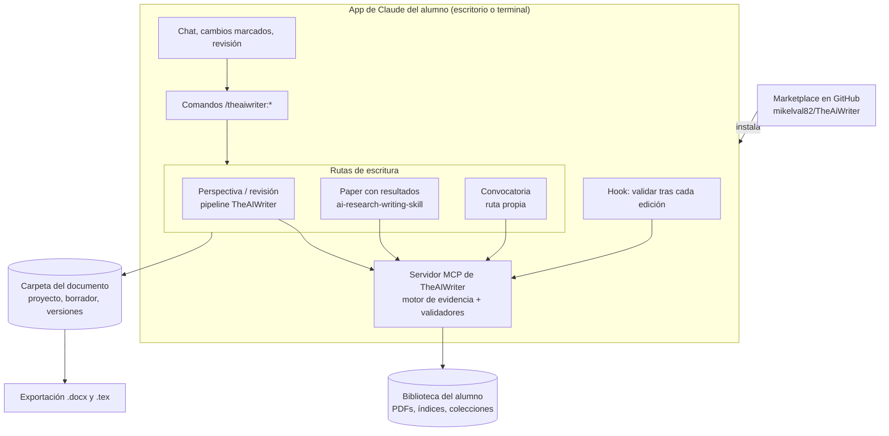

# Diseño: TheAIWriter como plugin de Claude Code para el curso del IDiBE

Estado: **propuesta para revisar, sin implementar**.
Fecha: 2026-11-12.
Sustituye a las fases 1.2 en adelante de `generalizacion-plantillas-resultados-convocatorias.md`. La Fase 0 y el paso 1.1 de ese plan ya están hechos y siguen valiendo.

## 1. Objetivo

Dar a los alumnos de un curso del IDiBE (Universidad Miguel Hernández) una herramienta para escribir tres tipos de documento a partir de sus propios materiales:

| Documento | Materiales del alumno | Quién escribe |
|---|---|---|
| Paper de perspectiva o revisión | Su colección de PDFs y una idea o abstract | Pipeline de TheAIWriter |
| Paper con resultados | Su análisis en Python (código, resultados, figuras) y sus PDFs | `ai-research-writing-skill`, conectada a la biblioteca del alumno |
| Memoria de convocatoria | Las bases de la convocatoria, un brief con los datos del proyecto y sus PDFs | Ruta propia de TheAIWriter |

La herramienta funciona sola de principio a fin y después deja revisar e iterar sobre el borrador.

### Condiciones de partida

- **Uso no comercial.** Se distribuye gratis a los alumnos.
- **Una persona por instalación**, sin coautores ni cuentas. Cada alumno la instala en su propio ordenador.
- **Cada alumno usa su propia cuenta de Claude**, ya sea una suscripción o una API key. Es lo que exigen las condiciones de Anthropic y evita que el coste recaiga en el curso.
- **Solo se exporta**: `.docx` y `.tex`. No se compila LaTeX y los retoques finales se hacen fuera de la herramienta.
- **No se rehace lo que ya existe.** TheAIWriter aporta solo lo que no está hecho: escribir desde el corpus propio con citas verificadas, y la parte comprobable de las convocatorias.

## 2. Arquitectura



### Qué contiene el marketplace

Un único repositorio (`mikelval82/TheAiWriter`) con:

- `.claude-plugin/marketplace.json`: el catálogo.
- El plugin `theaiwriter`: comandos, skills propias, servidor MCP, hooks y el paquete de Python.
- Una entrada que apunta a `ai-research-writing-skill` fijada en un commit concreto (hoy `e8b5de9`). **Por verificar** que el formato del catálogo admite plugins de otros repositorios (sección 7).
- Si hace falta, un segundo plugin pequeño con nuestras guías para revistas biomédicas, que complementa a `ai-research-writing-skill` sin tocar su código.

## 3. Componentes

### 3.1 Biblioteca del alumno

Una carpeta visible en sus documentos (por ejemplo `Documentos/TheAIWriter/biblioteca/`), compartida por todos sus documentos:

- `pdfs/`: los PDFs originales.
- `procesado/`: ideas, claims y referencias extraídos por paper; es lo que hoy está en `data/processed/`.
- `indices/`: embeddings y metadatos, con el modelo con que se generaron.
- `colecciones.yaml`: agrupaciones de papers ("Biomarcadores", "Revisión TFM"). Cada documento elige qué colecciones usa.
- `referencias.bib`: la bibliografía con claves estables. Si el alumno aporta un `.bib` exportado de Zotero, manda sobre lo extraído de los PDFs.

Añadir un PDF lo procesa una vez. Extraer ideas, claims y referencias son unas 6 a 10 llamadas al LLM por paper, con la cuenta del alumno.

### 3.2 Carpeta del documento

Es la carpeta donde el alumno abre Claude:

- `proyecto.yaml`: tipo de documento, idioma, colecciones, materiales y plantilla de exportación.
- `materiales/`: abstract, carpeta del análisis, bases de la convocatoria, brief.
- `borrador/documento.md`: el borrador, en Markdown con citas `[@clave]`. Es lo que el alumno lee y lo que el chat edita.
- `borrador/estado.json`: la estructura (secciones, párrafos con identificador, procedencia de cada cita y cifra) y el estado de cada fase, para reanudar.
- `revision/`: informe de huecos, evaluación simulada y resultado de los validadores.
- `exportacion/`: los `.docx` y `.tex`.
- Un repositorio git interno: cada fase terminada y cada cambio aceptado es un commit, así que se puede comparar y deshacer.

### 3.3 Servidor MCP: motor de evidencia y validadores

Es lo que comparten las tres rutas y lo que aporta TheAIWriter frente a las skills genéricas. Herramientas que expone:

| Herramienta | Qué hace |
|---|---|
| `buscar_evidencia` | Busca ideas y claims en las colecciones del documento. Devuelve texto, paper de origen y clave citable. Aplica la diversidad y la exploración por temas actuales |
| `temas_del_corpus` | Devuelve los temas (clusters) de las colecciones, para planificar |
| `referencia` | Devuelve los datos completos de una clave y su entrada BibTeX |
| `validar_citas` | Recibe texto y lista las citas que no existen en la biblioteca o que no estaban en la evidencia recuperada |
| `validar_documento` | Ejecuta todos los validadores sobre el borrador (citas, huecos `[[PENDIENTE]]`, extensión por sección) y escribe el informe |
| `estado_ejecucion` | Progreso de la ejecución automática en curso |

Arranca con `uv`, que crea el entorno de Python la primera vez sin que el alumno instale nada a mano.

### 3.4 Ruta de perspectiva y revisión (pipeline actual)

Es el pipeline que ya funciona: temas del corpus → plan párrafo a párrafo → escritura con evidencia por párrafo → revisión → citas resueltas. Cambios necesarios:

- **Estructura declarativa**: las secciones y su configuración salen de un perfil (perspectiva, revisión narrativa) en lugar de estar escritas en el código por nombre en español. Era el paso 1.3 del plan anterior.
- **Idioma como parámetro**, inglés por defecto (paso 1.4).
- **Ejecución en segundo plano y reanudable**: `/theaiwriter:escribir` lanza el proceso, guarda cada fase y vuelve al chat; `/theaiwriter:estado` muestra por dónde va (paso 1.5).
- **Pausa opcional tras el plan**, para revisarlo antes de escribir. Por defecto no se detiene.
- Sigue llamando a `claude -p` con la sesión del alumno, como ahora.

### 3.5 Ruta de paper con resultados

Usa `ai-research-writing-skill` tal cual, fijada en un commit. TheAIWriter añade:

- **Literatura desde la biblioteca**: una guía que indica a la skill usar `buscar_evidencia` y `referencia` para la posición frente a la literatura, además o en lugar de buscar en la web.
- **Perfil de revista biomédica**: estructura IMRaD, resumen estructurado y referencias a las guías CONSORT, STROBE y PRISMA según el tipo de estudio.
- **Exportación a `.docx`** desde el `.tex` que produce la skill.

Sus comprobaciones de cifras y citas se usan sin cambios.

### 3.6 Ruta de convocatorias (propia)

Ninguna herramienta existente hace la parte comprobable. La skill `grant-writing` es una guía de revisión pensada para becas de Estados Unidos, y los servicios comerciales quedan fuera porque cada alumno tendría que pagarlos. Pasos:

1. **Extraer las bases** a una ficha: secciones exigidas con su límite, criterios de evaluación con su peso, elementos obligatorios y reglas de formato, cada dato con la página de origen. El alumno la revisa antes de seguir.
2. **Brief y huecos**: el alumno rellena un brief con apartados fijos (idea, objetivos, equipo, resultados previos, recursos, presupuesto). Se compara con lo que exigen las bases y se lista lo que falta **antes** de escribir. Nunca se inventan personas, socios, cifras ni cartas.
3. **Estructura desde la ficha**: cada sección exigida pasa a ser una sección del documento, con su límite y los criterios que debe atender. La extensión se reparte según el peso de los criterios.
4. **Plan de trabajo**: paquetes, tareas, entregables e hitos como datos coherentes entre sí; el presupuesto se calcula con aritmética, no con el modelo.
5. **Escritura** sección a sección, con el estado del arte desde la biblioteca.
6. **Evaluación simulada** criterio a criterio, usando el método de auditoría de la skill `grant-writing` (requisito por requisito, presente, flojo o ausente, por prioridad), y una ronda de mejora.
7. **Comprobación de cumplimiento**: secciones obligatorias, límites de extensión y huecos.

Salida en `.docx`, opcionalmente con un documento de referencia de estilos que aporte el alumno.

### 3.7 Revisión e iteración

Todo ocurre en el chat de Claude, sin interfaz propia:

- **Cambios puntuales**: el alumno pide un cambio en el chat ("haz más crítico el tercer párrafo de la Discusión con evidencia de mi biblioteca"). Claude edita `documento.md` y la app muestra el cambio para aceptarlo o descartarlo.
- **Notas en bloque**: el alumno deja notas en el borrador con una sintaxis fija y `/theaiwriter:resolver` las aplica todas en una tanda automática.
- **Validación tras cada edición**: un hook ejecuta `validar_citas` después de cada cambio en el borrador, venga de donde venga, y avisa si aparece una cita que no existe.
- **Versiones**: cada cambio aceptado queda en el git interno del documento.

### 3.8 Exportación

`/theaiwriter:exportar` convierte `documento.md` con pandoc (`pypandoc-binary`, que no exige instalar pandoc):

- `.docx`, con estilos de un documento de referencia propio o del alumno.
- `.tex`, con una plantilla tipo arXiv, más `referencias.bib`, listo para subir a Overleaf.
- El informe de huecos y validación, junto a lo exportado.

### 3.9 Comandos

| Comando | Qué hace |
|---|---|
| `/theaiwriter:configurar` | Comprueba requisitos (uv, sesión de Claude, espacio en disco) y prepara la biblioteca |
| `/theaiwriter:biblioteca` | Añade PDFs o un `.bib` de Zotero, crea colecciones y muestra el estado |
| `/theaiwriter:nuevo` | Pregunta qué escribir y qué materiales hay; crea `proyecto.yaml` |
| `/theaiwriter:escribir` | Lanza la ruta que corresponda, en segundo plano |
| `/theaiwriter:estado` | Muestra el progreso o el resultado de la última ejecución |
| `/theaiwriter:resolver` | Aplica todas las notas del borrador |
| `/theaiwriter:validar` | Ejecuta los validadores y muestra el informe |
| `/theaiwriter:exportar` | Genera `.docx` y `.tex` |

## 4. Instalación para el alumno

Una vez:

1. Instalar la app de Claude e iniciar sesión con su cuenta.
2. Instalar `uv` (un comando según el sistema operativo).
3. Añadir el marketplace e instalar el plugin:
   ```bash
   claude plugin marketplace add mikelval82/TheAiWriter
   claude plugin install theaiwriter@theaiwriter
   ```
4. Ejecutar `/theaiwriter:configurar`. La primera vez descarga dependencias y el modelo de embeddings; son unos minutos.

Requisitos: cuenta de Claude, `uv`, menos de 1 GB libre y conexión a internet.

## 5. Qué pasa con el código actual

| Se mantiene | Cambia | Se elimina o queda fuera del plugin |
|---|---|---|
| Pipeline de escritura, `LLMClient`, `Embedder`, índices, exploración por clusters, procesado de PDFs | Rutas globales → biblioteca y carpeta de documento; secciones fijas → perfiles; CLI → comandos y servidor MCP | `analytics/` y la mayoría de `scripts/` (herramientas de desarrollo); `writers/pdf_writer.py`; todo lo que usa OpenAI, incluido `scripts/process_powerpoint.py` (decisión 10) |

El traductor (`TranslatorAgent`) deja de ser necesario si se escribe directamente en el idioma de destino. Se puede conservar como comando opcional.

## 6. Fases de implementación

Ordenadas por riesgo: primero se comprueba que el formato plugin funciona como suponemos.

### Paso previo: retirar OpenAI (Tamaño: S)
Verificado cuando: `grep -rni openai src config tests pyproject.toml .env.example ai-writer.spec` solo encuentra el comentario del modelo antiguo y los mensajes de error que avisan de que OpenAI ya no se admite, `pytest` pasa y `ai-writer version` muestra `claude-code` y `local`.
- Borrar `llm/backends/openai.py`, `OpenAIEmbedder` y la opción `openai` de `LLM_BACKEND` y `EMBEDDING_BACKEND`, con un error claro si alguien la configura.
- Quitar `openai_api_key`, los modelos por defecto de OpenAI y el bloque de `.env.example`; quitar `openai` de `pyproject.toml` y de `ai-writer.spec`.
- Borrar `scripts/process_powerpoint.py` (ya quedaba fuera del plugin) y la guarda de `tests/conftest.py`, que deja de tener sentido sin el paquete.
- Se mantiene `LEGACY_EMBEDDING_MODEL`, que sigue haciendo falta para reconocer índices antiguos y pedir `ai-writer reindex`.
- Actualizar README y `docs/architecture.md` cuando tus cambios pendientes en ellos estén commiteados, para no mezclarlos.
- Los vectores antiguos de `data/processed/embeddings/previous_text-embedding-3-small/` no están en git; se borran solo si lo confirmas.

### Fase A: Prueba de viabilidad del plugin (Tamaño: M)
Verificada cuando: un plugin mínimo, instalado desde el repositorio, funciona en la app de escritorio y en el terminal, en Linux y al menos en Windows o macOS.
- Un comando y un servidor MCP con una herramienta trivial, arrancado con `uv`.
- Comprobar cada punto de la sección 7 y anotar el resultado.
- Medir la primera instalación con sentence-transformers y con fastembed.
- Estado: hecho en Linux, en el terminal y en la app de escritorio (sección 7). Falta Windows o macOS.

### Fase B: Biblioteca y carpeta de documento (Tamaño: M)
Verificada cuando: el corpus actual (43 papers) se migra a una biblioteca sin reprocesar PDFs, y un documento nuevo usa una colección de ella.
- Rutas de usuario por sistema operativo, colecciones, `proyecto.yaml`.
- Cambiar `LocalEmbedder` a fastembed y quitar `sentence-transformers` y PyTorch de las dependencias.
- Comando `/theaiwriter:biblioteca`.

### Fase C: Motor de evidencia por MCP y citas verificadas (Tamaño: L, se divide en C1 y C2)
Verificada cuando: desde el chat de Claude se puede buscar evidencia en la biblioteca, y un texto con una cita inventada se rechaza.
- C1: claves estables y `referencias.bib`, con el `.bib` de Zotero como fuente preferente.
- C2: servidor MCP con las herramientas de la sección 3.3 y hook de validación.

### Fase D: Ruta de perspectiva dentro del plugin (Tamaño: L, se divide en D1 y D2)
Verificada cuando: `/theaiwriter:escribir` produce un paper de perspectiva completo en segundo plano, se puede reanudar tras un corte y todas sus citas pasan la validación.
- D1: perfiles de documento e idioma como parámetro.
- D2: ejecución en segundo plano, checkpoints, `/theaiwriter:estado` y pausa opcional tras el plan.

### Fase E: Revisión, notas y versiones (Tamaño: M)
Verificada cuando: una tanda de notas se aplica con `/theaiwriter:resolver`, cada cambio queda en el historial y se puede deshacer.

### Fase F: Exportación (Tamaño: S)
Verificada cuando: el paper de la Fase D se exporta a `.docx` y `.tex` con su bibliografía, y el `.tex` sube a Overleaf sin errores.

### Fase G: Ruta de paper con resultados (Tamaño: M)
Verificada cuando: con un análisis real tuyo, la skill produce un borrador cuyas cifras pasan su verificador y cuya literatura sale de tu biblioteca.
- Guía de literatura desde la biblioteca, perfil biomédico y exportación a `.docx`.

### Fase H: Ruta de convocatorias (Tamaño: L, se divide en H1, H2 y H3)
Verificada cuando: con las bases de una convocatoria real, se obtiene una memoria con todas las secciones exigidas, dentro de los límites, con informe de huecos y evaluación simulada.
- H1: ficha de las bases y brief con detección de huecos.
- H2: estructura desde la ficha, plan de trabajo y presupuesto.
- H3: escritura, evaluación simulada y cumplimiento.

### Fase I: Piloto con alumnos (Tamaño: M)
Verificada cuando: dos o tres alumnos instalan y usan la herramienta siguiendo solo la guía escrita.
- Guía de instalación con capturas para Windows y macOS.
- Recoger qué falla y qué no se entiende.

### Orden

```
Paso previo → A → B → C → D → E → F → G → H → I
```

G y H dependen de C y F, pero no entre sí. El piloto (I) puede empezar tras F, solo con la ruta de perspectiva.

## 7. Supuestos comprobados en la Fase A

Resultado de la prueba del 2026-11-12 en Linux, con Claude Code 2.1.322 y el plugin mínimo de `plugins/theaiwriter/` instalado desde el propio repositorio como marketplace:

| # | Supuesto | Resultado |
|---|---|---|
| 1 | Un plugin instalado desde el terminal aparece en la app de escritorio | **Sí.** En una sesión nueva de la pestaña Code, `/theaiwriter:diagnostico` respondió con el servidor MCP y `claude -p` (5,9 s con haiku) |
| 2 | El catálogo puede incluir plugins de otros repositorios fijados en un commit | **Sí.** `ai-research-writing-skill` se instala desde su repositorio fijada en `e8b5de9`, con `strict: false` y `skills: ["./"]`, porque no es un plugin sino una skill suelta. No hace falta copiarla |
| 3 | El servidor MCP se arranca con `uv` desde la carpeta del plugin | **Sí,** con `uv run --script ${CLAUDE_PLUGIN_ROOT}/mcp/servidor.py` y las dependencias declaradas en el propio script |
| 4 | Un hook se ejecuta tras editar un fichero concreto | **Sí.** El hook `PostToolUse` filtra por ruta (`borrador/documento.md`) y Claude recibe su mensaje; editar otros ficheros no lo dispara |
| 5 | Un proceso largo sigue en marcha mientras el alumno usa el chat | **Sí.** La herramienta MCP lanza un proceso separado y responde al momento; el proceso termina aunque se cierre la sesión. En Windows usa `DETACHED_PROCESS`, sin probar |
| 6 | `claude -p` funciona dentro de la sesión con la cuenta del usuario | **Sí,** desde el servidor MCP del plugin: respondió en 7 s con haiku |

Hallazgos que cambian cosas:

- **El SDK `mcp` está en la versión 2.x** y su API cambió: `FastMCP` es ahora `MCPServer`. El servidor fija `mcp>=2.3,<3`.
- **Un servidor MCP que falla al arrancar queda marcado como fallido 15 minutos.** Si la primera instalación de dependencias tarda más que el arranque permitido, el alumno se queda sin herramientas un rato. `/theaiwriter:configurar` tiene que preparar el entorno antes del primer arranque.
- **Instalación de los embeddings** (Linux, Python 3.12, entorno nuevo):

  | Opción | Tamaño | Notas |
  |---|---|---|
  | sentence-transformers con torch para CPU | 1,1 GB | En Linux hay que pedir el torch de CPU de forma explícita; si no, uv descarga la versión CUDA y ocupa 5,5 GB |
  | fastembed (ONNX) | 180 MB | No trae e5-small, pero lo carga con `add_custom_model` desde el ONNX oficial del modelo |

  Con fastembed, los vectores son **idénticos** a los del índice actual (coseno medio 1,000 y el mismo top 10 en el 100 % de 50 consultas sobre 300 ideas), así que se puede cambiar sin reindexar. Es algo más lento: unos 18 textos por segundo frente a unos 31.

## 8. Decisiones

Todas cerradas el 2026-11-12: la 1 y la 10 las decidiste tú; de la 2 a la 9 aceptaste mi recomendación tal como está escrita.

1. **Quién escribe en la ruta de perspectiva**: el pipeline actual con `claude -p`.
2. **Modelo de embeddings**: fastembed (ONNX, sin PyTorch) con el mismo modelo multilingüe. Comprobado en la Fase A: da los mismos vectores y la instalación baja de 1,1 GB a 180 MB (sección 7). El cambio se hace en la Fase B.
3. **Licencia del repositorio**: no tiene ninguna. PyMuPDF es AGPL, así que recomiendo publicar TheAIWriter con licencia **AGPL-3.0**. Como no se comercializa, no tiene coste, y permite seguir usando PyMuPDF. La alternativa es sustituir PyMuPDF por una librería con licencia permisiva, con riesgo de peor extracción de texto.
4. **`ai-research-writing-skill`**: referenciarla desde el catálogo, fijada en un commit, y poner nuestras guías en un plugin aparte. Solo copiarla si el supuesto 2 falla.
5. **Formato del borrador**: Markdown con citas `[@clave]`. Se edita bien en el chat y pandoc lo convierte a `.docx` y `.tex`.
6. **Ubicación de la biblioteca**: carpeta visible en los documentos del alumno, no oculta, para que sepa dónde están sus PDFs.
7. **Idioma de comandos, mensajes y guía**: español. Los documentos, en el idioma que elija cada alumno.
8. **Repositorio**: el mismo `TheAiWriter` hace de marketplace. Un repositorio separado solo si el catálogo crece.
9. **Propiedad intelectual**: aunque no se comercialice, confirmar con la UMH que puedes publicar el código con licencia abierta si lo desarrollas en el marco del IDiBE.
10. **OpenAI fuera del todo**: se retira cualquier uso de OpenAI con API key. Generación solo con `claude -p` y embeddings solo locales. Lo hace el paso previo a la Fase A (sección 6).

## 9. Lo que necesito de ti para las pruebas

- **Un análisis real en Python** (código, resultados en CSV o JSON, figuras) para la Fase G.
- **Unas bases de convocatoria reales** y un brief de ejemplo para la Fase H.
- **Acceso a un ordenador Windows o macOS** para la Fase A, o alguien del curso que pueda probarlo.

## 10. Siempre / Nunca

- Siempre: cada cita debe existir en la biblioteca del alumno; cada cifra de resultados, en sus ficheros; cada hecho del equipo o del presupuesto, en su brief. Lo que falta se marca como pendiente.
- Siempre: cada alumno con su propia cuenta de Claude.
- Nunca: comercializar ni cobrar por la herramienta; inventar personas, socios, cifras o cartas; ejecutar el código del análisis del alumno; compilar LaTeX; construir una interfaz propia mientras la app de Claude cubra lo necesario.

## 11. Progreso

| Fase | Estado |
|---|---|
| Fase 0 y paso 1.1 del plan anterior | hechos (`2888d1b`, `e93a9e6`) |
| Paso previo: retirar OpenAI | hecho salvo README y `docs/architecture.md` (esperan tus cambios) |
| A. Viabilidad del plugin | hecha en Linux (terminal y app); falta Windows o macOS |
| B. Biblioteca y documento | pendiente |
| C. Motor de evidencia por MCP | pendiente |
| D. Ruta de perspectiva | pendiente |
| E. Revisión y versiones | pendiente |
| F. Exportación | pendiente |
| G. Paper con resultados | pendiente |
| H. Convocatorias | pendiente |
| I. Piloto | pendiente |
